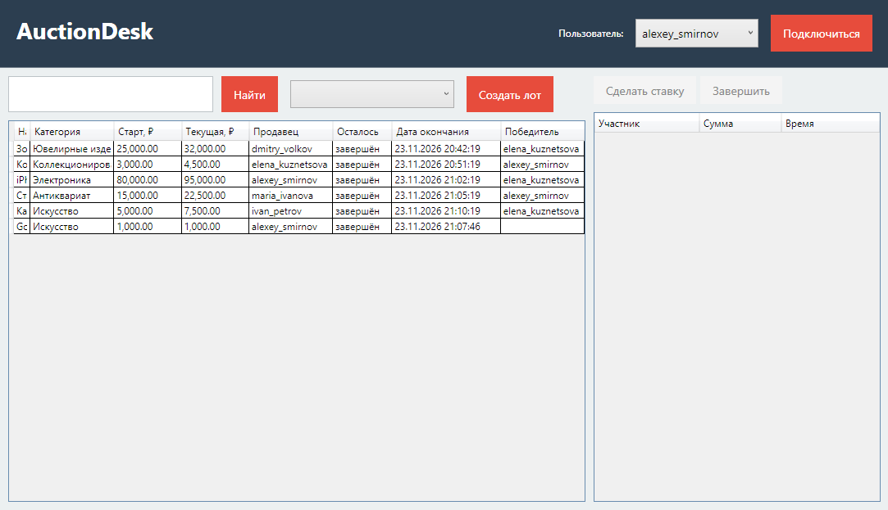
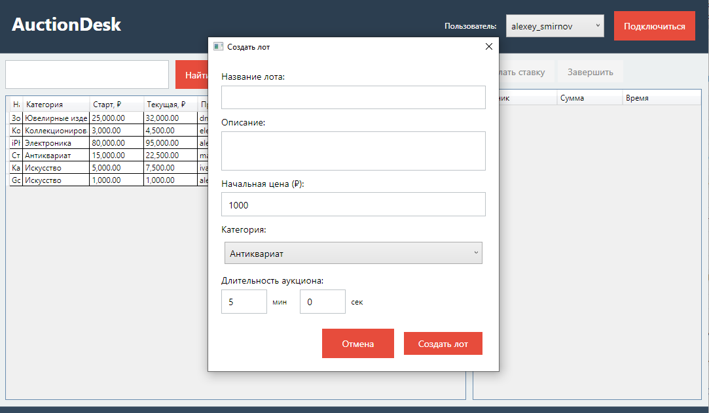

# AuctionDesk — Аукционная площадка

Междисциплинарная проектная работа № 2 «Разработка настольной информационной системы».

## Автор и тема

| Поле | Сведения |
| --- | --- |
| ФИО | Григорьев Никита Егорович |
| Группа | 9/2-РПО-24/1 |
| Тема | 14. AuctionDesk — Аукционная площадка |
| Срок выполнения | 27.10.2026 — 24.11.2026 |
| Формат | Индивидуальная работа |

## Назначение системы

Система предназначена для проведения электронных аукционов. Пользователь выставляет лот, задаёт начальную цену и длительность торгов в минутах и секундах, после чего остальные участники делают ставки. По истечении времени лот закрывается автоматически, победителем становится участник с максимальной ставкой.

Приложение автоматизирует учёт лотов, участников, ставок и фиксации победителей с соблюдением бизнес-правил аукциона. Пользователи выступают в двух ролях: продавец лота (создаёт лот и завершает торги) и покупатель (делает ставки). Роль определяется выбором текущего пользователя из списка.

## Реализованные возможности

| Возможность | Краткое описание | Состояние |
| --- | --- | --- |
| Каталог лотов | Таблица всех лотов: название, категория, начальная и текущая цена, продавец, оставшееся время, дата окончания, победитель | Реализовано |
| Создание лота | Форма с названием, описанием, начальной ценой, категорией и длительностью торгов (минуты и секунды) | Реализовано |
| Внесение ставки | Ставка от имени выбранного пользователя с проверкой бизнес-правил внутри транзакции | Реализовано |
| Обратный отсчёт | Таймер обновляет оставшееся время активных лотов каждую секунду в формате мм:сс | Реализовано |
| Автоматическое завершение | По истечении времени лот закрывается, определяется победитель и заполняется фактическая дата окончания | Реализовано |
| Ручное завершение | Продавец лота может завершить торги досрочно с подтверждением действия | Реализовано |
| История ставок | При выборе лота автоматически отображаются все его ставки с участником, суммой и временем | Реализовано |
| Поиск и фильтрация | Поиск по части названия лота и фильтр по категории, включая пункт «Все категории» | Реализовано |
| Смена пользователя | Выбор текущего пользователя из списка для демонстрации ролей продавца и покупателя | Реализовано |
| Агрегированный отчёт | Представление `vw_lot_report`: количество лотов, завершённых лотов и выручка по категориям | Реализовано на уровне БД |

## Технологии и зависимости

| Компонент | Версия / сведения |
| --- | --- |
| Windows | Windows 11 |
| .NET | .NET 8.0, целевая платформа `net8.0-windows` |
| Интерфейс | WPF, паттерн MVVM |
| Microsoft SQL Server | SQL Server 2022 |
| Microsoft.Data.SqlClient | 5.2.0 |
| Среда разработки | Visual Studio Code + C# Dev Kit |
| Другие зависимости | Нет |

## Структура репозитория

```
auctiondesk/
├── src/
│   └── AuctionDesk.App/          # Исходный код приложения
│       ├── Models/               # Классы данных: Lot, Bid, Category, User
│       ├── Data/                 # Доступ к данным через ADO.NET
│       ├── ViewModels/           # Логика представления (MVVM)
│       ├── Views/                # Окно создания лота
│       ├── App.xaml
│       ├── MainWindow.xaml
│       └── AuctionDesk.App.csproj
├── database/
│   ├── README.md                 # Порядок развёртывания БД
│   ├── schema.sql                # Создание схемы БД
│   └── seed.sql                  # Тестовые данные
├── docs/
│   ├── requirements.md           # Требования, правила и транзакционный сценарий
│   ├── database-schema.md        # Описание модели данных
│   ├── database-schema.png       # ER-диаграмма
│   └── testing.md                # Сценарии и результаты тестирования
├── screenshots/                  # Скриншоты ключевых экранов
├── START_HERE.md                 # Инструкция и календарь проекта
├── README.md
└── .gitignore
```

## Запуск на другом компьютере

### 1. Подготовка

Получите исходный код из этого репозитория.

Установите .NET 8.0 SDK

Установите Microsoft SQL Server (Express или LocalDB) и SQL Server Management Studio.

Откройте папку `src/AuctionDesk.App` в Visual Studio Code. Файл решения `AuctionDesk.slnx` находится в папке `src/`.

### 2. Развёртывание базы данных

Подключитесь к своему экземпляру SQL Server в SSMS через Windows Authentication. Имя экземпляра узнаётся запросом `SELECT @@SERVERNAME`.

Выполните `database/schema.sql` — скрипт создаёт базу `AuctionDesk`, 5 таблиц, индексы и представление.

Выполните `database/seed.sql` — скрипт наполняет базу тестовыми данными.

Проверьте наличие таблиц `users`, `categories`, `lots`, `bids`, `winners` запросом:

```sql
USE AuctionDesk;
SELECT TABLE_NAME FROM INFORMATION_SCHEMA.TABLES WHERE TABLE_TYPE = 'BASE TABLE' ORDER BY TABLE_NAME;
```

Подробности: [инструкция по базе данных](database/README.md).

### 3. Настройка подключения

Строка подключения задаётся в файле `src/AuctionDesk.App/Data/Database.cs`:

```csharp
public static string ConnectionString { get; } =
    @"Server=DESKTOP-MTDRK23;Database=AuctionDesk;Integrated Security=true;TrustServerCertificate=true;";
```

Используется Windows-аутентификация, пароли и токены в репозитории не хранятся. При переносе на другой компьютер измените значение `Server=` на имя своего экземпляра SQL Server. Пользователь Windows должен иметь права на чтение базы `AuctionDesk`.

### 4. Запуск приложения

```bash
cd src/AuctionDesk.App
dotnet restore
dotnet run
```

Запускаемый проект — `AuctionDesk.App`. Откроется главное окно AuctionDesk. Выберите пользователя в правом верхнем углу и нажмите «Подключиться»: в таблице появятся лоты из SQL Server, а у активных лотов начнётся обратный отсчёт. Это действие проверяет подключение к реальной БД.

## Бизнес-правила и транзакция

**BR-01:** новая ставка должна быть строго выше текущей цены лота. Ставка, равная или меньшая текущей цены, отклоняется с сообщением «Ставка должна быть выше {сумма} руб.».

**BR-02:** после закрытия лота (статус `completed`) и после истечения времени торгов внесение ставок запрещено.

**BR-03:** продавец лота не может делать ставки на собственный лот.

**BR-04:** завершить лот вручную может только его продавец.

**TX-01:** внесение ставки. В одной транзакции выполняется чтение текущей цены, статуса, продавца и срока лота с блокировкой строки (`WITH (UPDLOCK)`), проверка BR-01 — BR-03 и срока торгов, вставка записи в `bids` и обновление `current_price` в `lots`. При нарушении любого условия или при ошибке SQL вызывается `Rollback()`: ставка не сохраняется, цена лота не изменяется, пользователь получает сообщение об ошибке.

Подробное описание: [требования](docs/requirements.md).

## Скриншоты



Главный экран: каталог лотов с обратным отсчётом, поиск, фильтр по категории и выбор текущего пользователя.



Создание лота: создание лота, указание имени, описания, цены и времени окончания аукциона.

## Документация и проверка

- [Требования и границы проекта](docs/requirements.md)
- [Модель данных](docs/database-schema.md)
- [Тестовые сценарии и фактические результаты](docs/testing.md)

## Известные ограничения

- Аутентификация по паролю не реализована: текущий пользователь выбирается из списка, что достаточно для демонстрации ролей.
- Агрегированный отчёт реализован представлением `vw_lot_report` и проверяется запросом в SSMS; отдельный экран отчёта в интерфейсе не выводился.
- Шаг ставки фиксированный (+500 ₽), ввод произвольной суммы не предусмотрен.
- Удаление лотов не реализовано: вместо удаления используется архивирование через перевод лота в статус `completed`.
- Нет уведомлений в реальном времени, импорта из файлов и экспорта отчётов в PDF/Excel.
- Результаты проверок и состояние дефектов приведены в [тестировании](docs/testing.md).
